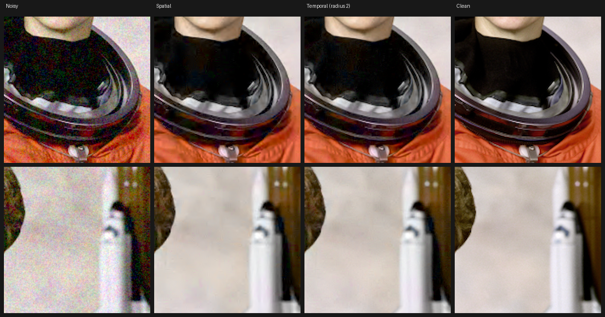
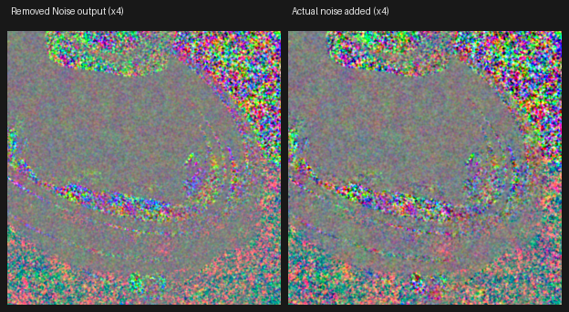

# SpectralDenoise

A profile-based noise reduction OFX plugin for Nuke and Flame, in the spirit of
Neat Video. You show it a patch of the shot with no detail in it (sky, a wall,
a grey card, out-of-focus background). It measures exactly what the noise looks
like there: how strong it is at every spatial frequency, separately for
brightness and colour, at four scales, plus how it changes from shadows to
highlights. It then removes only what matches that profile, so detail that
doesn't look like the noise is kept. With a temporal radius it also matches
every block in the neighbouring frames, accounting for motion, which makes the
reduction much stronger.



*Film-grain-like noise with blotchy colour noise on top (25.8 dB). Spatial:
32.7 dB. Temporal, radius 2: 34.4 dB. Crops at 100%.*



*Output → Removed Noise shows what was taken out. It should look like the
actual noise (right) with no edges or texture in it.*

## Install

### Get the plugin

**Download:** every push builds the plugin for macOS (Apple Silicon and Intel),
Linux and Windows. Open the repository's **Actions** tab, then the latest
**SpectralDenoise** run, and download the artifact for your platform from the
bottom of the page. Unzip it, then extract the archive inside
(`SpectralDenoise-linux.tar.gz`, `SpectralDenoise-macos.zip` or
`SpectralDenoise-windows.zip`) to get the `SpectralDenoise.ofx.bundle`
folder. Hosts only load the plugin inside that folder.

**Or build it yourself** (macOS or Linux; you need CMake, git and a C++
compiler: on a Mac, `xcode-select --install` and `brew install cmake`):

```sh
cd SpectralDenoise
./build.sh            # makes build/SpectralDenoise.ofx.bundle
```

### Put it where the host looks

```sh
./install.sh                                   # the bundle you just built
./install.sh ~/Downloads/SpectralDenoise.ofx.bundle   # or a downloaded one
```

This copies the bundle to the standard OFX folder (macOS:
`/Library/OFX/Plugins`, Linux: `/usr/OFX/Plugins`), removes the macOS
download quarantine and clears Nuke's OFX plugin cache. Windows: copy the
bundle to `C:\Program Files\Common Files\OFX\Plugins`.

You can also keep it anywhere and point `OFX_PLUGIN_PATH` at the folder that
contains the bundle.

**Nuke:** restart Nuke. The node is under **JointPost › SpectralDenoise** in
the Nodes toolbar (or Tab, then type SpectralDenoise).

**Flame:** restart Flame. It's in the OFX section of the effects browser /
Batch node bin under JointPost.

## Using it

1. Put the node after your plate (linear, as Nuke works, or log / video, see
   **Input Colourspace**).
2. In the viewer, drag the yellow **analysis box** onto an area with no
   detail. Bigger is better: 256 × 256 or more catches blotchy, low-frequency
   noise too. Drag a corner to resize, drag inside to move.
3. Press **Analyse Noise**. This sets **Analysis Frame** to the current frame
   and **Profile** to **Analysed**. From then on, the box is measured on that
   frame whenever the node renders (once, then cached), whichever frame is
   being rendered. The script stores only the box and the frame number,
   ordinary parameters that Nuke scripts and Flame setups both save, so the
   shot renders the same on the farm and in other hosts.
4. Set **Output** to **Removed Noise** and check that what's being removed
   looks like noise, with no edges or texture. If you see detail, lower
   **Noise Level** (or Fine / Medium for that size of detail). If noise is
   left, raise it.
5. For a moving shot, leave **Temporal Radius** at 1 or raise it to 2. If
   fast motion shows ghosting, lower **Motion Tolerance**.

Analyse on a frame that's typical of the shot. One profile normally serves
the whole shot, because noise depends on the camera and exposure, not on the
content.

### Controls

**Noise Profile**

| Control | What it does |
|---|---|
| Profile | **Analysed**: the box measured on the Analysis Frame (recommended). **Region (every frame)**: measures the box on every frame. Use it when the noise changes over the shot (a gain ramp) and the box stays on a flat area. **Auto (every frame)** (default until you analyse): finds the flattest parts of each frame itself. It's convenient but deliberately cautious with blotchy colour noise |
| Box Bottom Left / Top Right | The analysis box. Drag it in the viewer |
| Analyse Noise | Uses the box on the current frame: sets Analysis Frame to this frame and Profile to Analysed. Reads no image itself, so it works in any host |
| Analysis Frame | The frame the box is measured on in Analysed mode. You can also type it. Moving the box, or changing the frame or Input Colourspace, re-measures on the next render |
| Status | Which profile mode is in use. If the box is too small (under 24 × 24 pixels) or off the image, Auto is used instead |
| Input Colourspace | **Scene Linear**: for linear-light plates. A log-like curve is applied internally so shadow and highlight noise are handled evenly. **Log / Video**: log or display-referred material, processed as is |
| Brightness Adaptive | Follows how noise changes with brightness (measured over the whole frame when you analyse). Off: the box's noise level is used everywhere |

**Reduction**

| Control | What it does |
|---|---|
| Noise Level | Scales the whole profile. 1 = remove what was measured. Above 1 removes more, and starts to eat fine detail; below 1 keeps more |
| Luma Level / Chroma Level | The same, for brightness noise and colour noise separately. Colour noise can usually go higher |
| Luma Reduction / Chroma Reduction | How much of the removed noise to take away (1 = all). 0.7 on luma keeps a little grain, which often looks more natural |
| Fine / Medium / Coarse / Very Coarse | Noise level per scale: pixel-sized grain, a few pixels, blotches (~10 px), large blotches |
| Sharpen | A little luma sharpening on the result |

**Temporal**

| Control | What it does |
|---|---|
| Temporal Radius | Frames used on each side (0 to 3). Each 8 × 8 block is matched in the neighbouring frames with quarter-pixel motion search. Where a match is too different (motion the search can't follow, occlusion, a flash), that frame is left out for that block. A frame that hardly matches anywhere, such as across a cut, is left out entirely |
| Motion Tolerance | How different a matched block may be. Lower it if moving objects ghost; raise it for more reduction on static shots |

**Output**

| Control | What it does |
|---|---|
| Quality | Fast: one pass, sparse blocks. Normal: two passes. Best: two passes, denser blocks (about 1.5× Normal's time, about 0.3 dB better) |
| Use GPU | Run on the GPU (OpenCL) when there is one. Turn it off if the GPU is busy with other work or misbehaves; the CPU gives the same result. The environment variable `SD_OPENCL=off` turns it off for every node, e.g. on a farm |
| GPU | The GPU found, or why none is used |
| Output | Denoised, or Removed Noise (source minus result) to check your settings |
| Mix | Blend with the source |
| Mask / Invert Mask | In Nuke, the node has a mask input: denoise only inside it |

## How well it works

Measured on test images with known noise added. All figures are PSNR
(higher is better), with the measured profile and default settings:

| Noise | Noisy | Spatial | Temporal r=1 | Temporal r=2 |
|---|---|---|---|---|
| Sensor noise (photon + read), panning shot | 31.5 dB | 40.7 | 42.1 | 42.8 |
| Film-grain-like (correlated), panning shot | 28.1 dB | 34.6 | 35.7 | 36.3 |
| Grain + blotchy chroma noise, region profile | 27.6 dB | 33.9 | | |

For reference, on single images with an exact profile it comes within
0.3 to 1 dB of colour BM3D, the standard academic benchmark, at roughly 100×
the speed.

## Performance

**GPU.** With **Use GPU** on (the default), the denoising runs on the GPU
through OpenCL: NVIDIA on Linux and Windows, Apple Silicon (and AMD) on
macOS. The **GPU** line under Output shows which device it found. The GPU
computes the same result as the CPU; in the tests the two differ by at most
0.00003. If there's no GPU, or the GPU hits an error, that frame is done on
the CPU instead. GPU speed hasn't been measured yet (the build machines have
no GPU); please report what you see.

**CPU.** A 2048 × 1080 frame on a 4-core cloud machine:

| Quality | Spatial | Radius 1 | Radius 2 |
|---|---|---|---|
| Fast | 0.44 s | 1.2 s | 1.9 s |
| Normal | 0.63 s | 2.5 s | 4.4 s |
| Best | 1.1 s | 4.7 s | 8.1 s |

It uses all CPU cores, so a 16-core workstation should be roughly 3 to 4×
faster. Auto profile mode adds about 0.4 s per frame; Analysed mode measures
the box once and caches it. In a downscaled viewer or proxy mode the box is
measured on the downscaled image, so previews match the full-resolution
render.

## How it works

The work is done in a small C++ core (`src/core`) with no OFX dependency. The
OFX plugin (`src/ofx/SpectralDenoise.cpp`) is a thin layer over it. The GPU
path (`src/core/gpu.cpp`, kernels in `src/core/kernels_cl.h`) runs step 4's
motion search and filtering passes in OpenCL, one work group per block, with
the same arithmetic as the CPU code. OpenCL is loaded at run time, so the
plugin needs nothing extra installed.

1. **Working space.** Scene-linear input goes through an asinh curve, which is
   linear in the shadows and logarithmic above. Then an orthonormal opponent
   transform separates luma from two chroma channels.
2. **Pyramid.** Four levels, each half the size of the previous one, so noise
   of every size is handled by 8 × 8 blocks at some level.
3. **Profile.** For each level and channel, the noise standard deviation of
   each of the 64 DCT coefficients. It's measured on differences between
   neighbouring blocks, which cancels gradients in the box, with a median so
   stray detail doesn't count. The brightness curve comes from the flattest
   blocks of the whole frame, grouped by brightness. Levels the box is too
   small for are predicted by synthesising noise with the measured spectrum
   and downsampling it.
4. **Denoising.** Overlapping 8 × 8 blocks (every 2 to 4 pixels) are
   transformed with a 2D DCT, plus a DCT along time when there are matched
   blocks from other frames. Pass 1 zeroes coefficients below 2.7 × the
   profile's noise, giving a pilot image. Pass 2 Wiener-filters every
   coefficient using the pilot as the estimate of the clean signal. Results
   are blended with a Kaiser window.
5. **Recombination.** Each level contributes its own band of frequencies
   (Laplacian pyramid).

## Tests

```sh
cd tests
python3 -m pytest -q        # needs numpy, scipy, pytest, cmake, expat, GL and OpenCL headers;
                            # GPU tests need pocl (apt install pocl-opencl-icd)
```

- `test_core.py` tests the maths through a C API (`src/core/capi.cpp`):
  profile accuracy against known noise, noise reduction, edge sharpness,
  every control, temporal gain without ghosting, shot cuts, odd sizes,
  NaN/inf input, and determinism across thread counts.
- GPU tests run the OpenCL code on pocl (a CPU OpenCL driver) and check it
  against the CPU path, in the core and through the plugin.
- `test_ofx.py` loads the **built plugin** into a scriptable OFX host
  (`tests/host`, built on the OpenFX HostSupport reference library). It sets
  parameters, presses Analyse Noise, renders, and checks that the frames
  requested (including the Analysis Frame), mask, mix, Removed Noise
  output, identity, profile modes, fallbacks and half render scale all
  behave correctly. It also checks that rendered pixels match the core bit
  for bit.

CI (`.github/workflows/spectraldenoise.yml`) runs the tests and builds the
macOS, Linux and Windows bundles.

## Not yet verified inside a real host

Everything above is tested against the OpenFX reference host library, not in
Nuke or Flame themselves. Please check these and report back:

- [ ] Nuke loads the bundle, and the node appears under JointPost.
- [ ] The analysis box draws in the Nuke viewer and its corners and body drag.
- [ ] **Analyse Noise** sets Analysis Frame and Profile → Analysed in Nuke,
      and the result changes visibly from Auto (compare Output → Removed
      Noise before and after).
- [ ] With the Analysis Frame outside the current temporal window, Nuke
      supplies that frame (it's requested through the OFX frames-needed
      action).
- [ ] Temporal Radius fetches neighbouring frames in Nuke and at clip ends.
- [ ] The mask input works in Nuke.
- [ ] Proxy / downscaled viewer gives a preview that matches the full render.
- [ ] Flame: loads (Linux and macOS), renders, and temporal frames work.
      Flame's support for overlays and for reading images on a button is
      untested; Region (every frame) is the fallback.
- [ ] Windows build: compiled in CI, never run.
- [ ] **GPU:** the GPU line names your NVIDIA card / Apple GPU, renders match
      Use GPU off, and it is faster. The OpenCL code is tested here on a CPU
      OpenCL driver only.

## Troubleshooting

| Symptom | Fix |
|---|---|
| Node not in Nuke's menu | Check the bundle is in `/Library/OFX/Plugins` (macOS) or `/usr/OFX/Plugins` (Linux), or on `OFX_PLUGIN_PATH`. Delete `~/.nuke/ofxplugincache` and restart |
| macOS says the plugin is damaged or can't be checked | It's quarantined after download: `sudo xattr -dr com.apple.quarantine /Library/OFX/Plugins/SpectralDenoise.ofx.bundle` (install.sh does this) |
| Analysed looks the same as Auto | The box is probably smaller than 24 × 24 pixels or off the image, so Auto is used. Make it bigger and check it's over the plate on the Analysis Frame |
| Detail is being removed | Look at Output → Removed Noise. Lower Noise Level, or the Fine / Medium level for that size of detail. Make sure the box had no detail in it |
| Blotchy colour noise left | Use a bigger analysis box (it measures the coarse levels), raise Chroma Level or Coarse / Very Coarse, or add temporal radius |
| Ghosting on fast motion | Lower Motion Tolerance, or Temporal Radius |
| Slow | Check the GPU line shows your GPU and Use GPU is on. Quality Fast and Temporal Radius 1 while working; Normal or Best for the final render |
| GPU line says "not available" | No OpenCL driver was found. NVIDIA: the normal NVIDIA driver includes OpenCL. macOS: built in. A farm without GPUs just uses the CPU |
| Crashes or garbage with Use GPU on | Turn Use GPU off (or set `SD_OPENCL=off`) and send me the GPU line and the terminal output |
